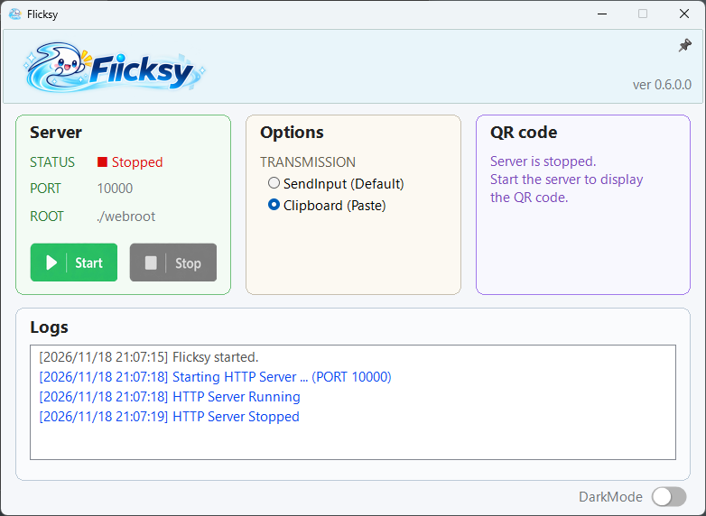
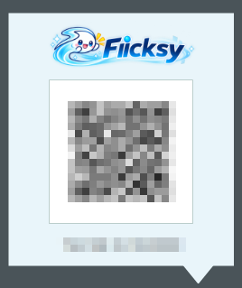
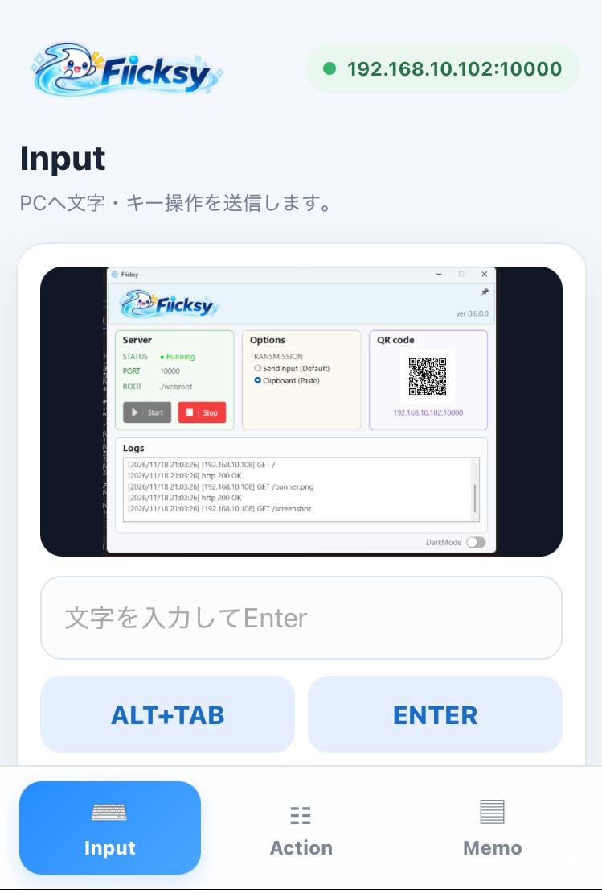
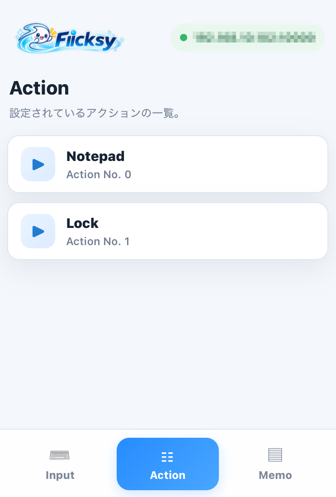
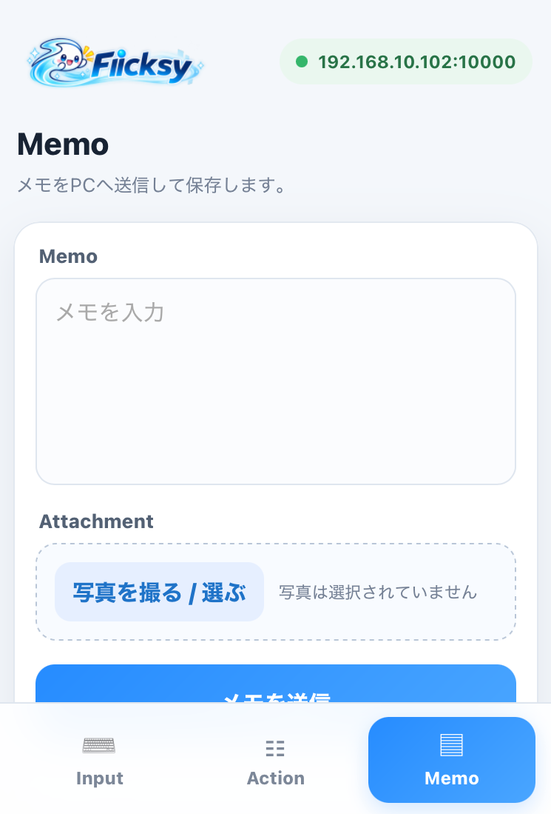

# Flicksy v0.6.0.0

### English

Flicksy is a Windows application that lets you control a PC
from a smartphone browser over a local network.

No dedicated mobile app is required.
Just connect through your web browser.

<p align="center">• • •</p>

### 日本語

Flicksy は、スマートフォンのブラウザから
Windows PC を操作するためのローカルリモートツールです。

スマートフォン側に専用アプリは不要です。
PC とスマートフォンを同じネットワークへ接続し、
QRコードからブラウザでアクセスできます。


## Server (Windows PC)






## Client (Smartphone)








## Features / 主な機能

### Text & Key Input

- Send text from a smartphone to the active Windows application.
- Supports SendInput and Clipboard input modes.
- Remote keys such as Enter, Esc, Tab, Backspace and arrow keys.
- Alt+Tab remote control.

<p align="center">• • •</p>

- スマートフォンのフリック入力からPCへ文字を送信できます。
- SendInput / Clipboard の2種類の入力方式に対応しています。
- Enter、Esc、Tab、Backspace、カーソルキーなどを送信できます。
- Alt+Tabによるウィンドウ切り替えに対応しています。


### Screenshot

- Preview the active PC window from the smartphone.
- Full-screen screenshot viewer.
- Refresh screenshots manually.
- Basic keyboard operations are available from the screenshot screen.

<p align="center">• • •</p>

- PCのアクティブウィンドウをスマートフォンから確認できます。
- スクリーンショットの全画面表示に対応しています。
- 必要なタイミングで画面を更新できます。
- スクリーンショット画面から基本的なキー操作を行えます。


### Action

Custom actions can be registered from Flicksy Config
and executed from the smartphone.

Supported action types:

- Open URL
- Execute application
- Open folder
- Lock Windows
- Shut down Windows

<p align="center">• • •</p>

Flicksy Configで登録した操作を
スマートフォンからワンタップで実行できます。

対応するAction:

- Webサイトを開く
- アプリケーションを起動
- フォルダを開く
- Windowsをロック
- Windowsをシャットダウン


### Memo

Send memos from the smartphone and store them on the PC.

- Text memo
- Optional image attachment
- JPEG / PNG / WebP attachments
- Memo list and editor in Flicksy Config
- Attachment preview
- Open attachments with the default Windows image viewer
- Save attachments to another location
- Delete attachments

Memo data is stored in `fmemo.toml`.

Attachments are stored under the configured Data Folder.

<p align="center">• • •</p>

スマートフォンからPCへメモを送信し、
Flicksy内で管理できます。

- テキストメモ
- 画像添付
- JPEG / PNG / WebP対応
- Config画面でのメモ一覧・編集
- 添付画像プレビュー
- Windows既定の画像ビューアで表示
- 添付画像の保存
- 添付画像の削除

メモ情報は `fmemo.toml` に保存され、
画像はData Folder配下に保存されます。


## Config

Flicksy includes a configuration window for managing:

- Server settings
- Actions
- Memos
- Security
- Appearance
- Logging
- Data folder
- Startup behavior

<p align="center">• • •</p>

Config画面から以下を設定・管理できます。

- サーバー設定
- Action
- Memo
- Security
- 外観
- ログ
- Data Folder
- 自動起動・サーバー自動開始


## Security / セキュリティ

### Access Token

By default, Flicksy uses a temporary access token
for smartphone requests.

The token is generated each time the server starts
and is included in the connection URL.

Token authentication can be disabled from the Security settings.

> [!WARNING]
> Disabling the authentication token may allow other devices
> on the same network to access Flicksy.
> Use this option only on trusted networks.

<p align="center">• • •</p>

Flicksyは標準で一時アクセストークンを使用します。

トークンはサーバー起動時に生成され、
スマートフォン接続用URLへ付加されます。

Security設定からトークン認証を無効にすることもできます。

> [!WARNING]
> 認証トークンを無効にすると、
> 同一ネットワーク上の他の端末から
> Flicksyへアクセスできる可能性があります。
> 信頼できるネットワークでのみ使用してください。


### Config Password

The Config window can optionally be protected by a password.

Passwords are not stored directly.
Flicksy stores a PBKDF2-derived hash and random salt.

> [!NOTE]
> Config password protection is intended to prevent casual
> or accidental access to the configuration screen.
> It does not protect against users who can directly modify
> Flicksy configuration files.

<p align="center">• • •</p>

Config画面には任意でパスワードを設定できます。

パスワードそのものは保存せず、
ランダムSaltとPBKDF2によるハッシュ値を保存します。

> [!NOTE]
> Configパスワードは、設定画面への不用意なアクセスを防ぐための
> 簡易的な保護機能です。
> 設定ファイルを直接編集できるユーザーからの保護を
> 目的とするものではありません。


## Structure

```text
Smartphone
    ↓
Browser
    ↓
HTTP
    ↓
Flicksy
    ├─ SendInput / Clipboard
    ├─ Screenshot
    ├─ Action
    └─ Memo
         ↓
      Windows
```


## How to use

### English

1. Start `Flicksy.exe` on your Windows PC.
2. Click `START` to start the local HTTP server.
3. Make sure your smartphone and PC are connected to the same network.
4. Scan the QR code shown in Flicksy with your smartphone.
5. Open the displayed page in your browser.
6. Use Input, Action, or Memo from the bottom navigation.

When `Start server automatically` is enabled,
Flicksy can start the server automatically on launch.

<p align="center">• • •</p>

### 日本語

1. Windows PCで `Flicksy.exe` を起動します。
2. `START` を押してローカルHTTPサーバーを開始します。
3. PCとスマートフォンを同じネットワークへ接続します。
4. Flicksyに表示されたQRコードをスマートフォンで読み取ります。
5. ブラウザでFlicksyのページを開きます。
6. 下部メニューから Input / Action / Memo を使用します。

「Start server automatically」を有効にすると、
Flicksy起動時にサーバーを自動開始できます。


## System Tray / タスクトレイ

Flicksy can remain active in the Windows system tray.

- Double-click the tray icon to restore the main window.
- Server status is shown in the tray tooltip.
- Notifications are displayed when the server starts, stops, or encounters an error.
- The connection QR code can be displayed from the tray menu.

<p align="center">• • •</p>

FlicksyはWindowsのタスクトレイに常駐できます。

- トレイアイコンをダブルクリックするとメイン画面を表示します。
- ツールチップにサーバー状態を表示します。
- サーバーの開始、停止、エラー時に通知を表示します。
- トレイメニューから接続用QRコードを表示できます。


## v0.6.0.0

Major additions in this release:

- Added Memo feature.
- Added image attachments to Memo.
- Added Memo management in Config.
- Added custom Action management.
- Added Config password protection.
- Added optional access-token authentication.
- Improved Config UI and owner-drawn controls.
- Improved smartphone UI.

<p align="center">• • •</p>

v0.6.0.0 主な変更:

- Memo機能を追加
- Memo画像添付に対応
- ConfigからのMemo管理機能を追加
- Action登録・編集機能を追加
- Configパスワード保護を追加
- アクセストークン認証のON/OFF設定を追加
- Config UI / オーナードローを改善
- スマートフォンUIを改善


## Roadmap

### v0.7

Mouse control.

Planned ideas:

- Use the screenshot area as a touchpad.
- Relative mouse movement.
- Left / right click.
- Mouse wheel / scrolling.
- Possible direct interaction with screenshots.

<p align="center">• • •</p>

v0.7ではマウス操作機能を予定しています。

- スクリーンショット領域のタッチパッド化
- 相対マウス移動
- 左クリック / 右クリック
- ホイール操作
- 将来的なスクリーンショット直接操作


## Development

- C++17
- Win32 API
- GDI / GDI+
- Visual Studio 2022
- HTML / CSS / JavaScript
- Local HTTP server


## Limitations

> [!WARNING]
> Administrator-elevated applications cannot receive remote
> text or key input from Flicksy when Flicksy is running
> without elevation.

Flicksy is designed primarily for use on trusted local networks.


## Dependencies

- [cpp-httplib](https://github.com/yhirose/cpp-httplib) - MIT License
- [QR-Code-generator](https://github.com/nayuki/QR-Code-generator) - MIT License
- [toml++](https://github.com/marzer/tomlplusplus) - MIT License
- [nlohmann/json](https://github.com/nlohmann/json) - MIT License

All third-party libraries listed above are licensed under the MIT License.

See `THIRD_PARTY_LICENSES.txt` for details.

Visual Studio 2022 project files are included.


## Status

Work in progress.

This project is developed as a personal project and is still evolving.

Please test it sufficiently in your own environment before using it
for important or production workflows.

<p align="center">• • •</p>

現在開発中です。

個人開発のプロジェクトであり、現在も改善を続けています。

重要な用途や実運用へ導入する前に、
利用環境で十分な検証を行ってください。


## License

This project is licensed under the MIT License.