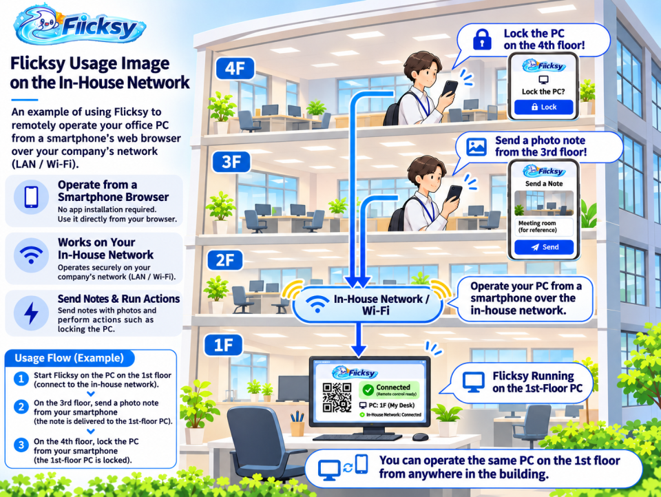

[日本語](README_ja.md)

<div align="center">

# Flicksy v0.6.1.0

### Control your Windows PC from a smartphone browser over your local network / Wi-Fi.

**No dedicated mobile app required.**  
Start Flicksy on your PC, scan the QR code, and connect from your smartphone browser.



<br>

**Input · Screenshot · Action · Memo**

</div>

---

## What is Flicksy?

Flicksy is a lightweight Windows application that lets you interact with your own PC from a smartphone browser on the same local network.

You can move around your office while keeping access to the PC at your desk—for example, sending a photo memo from another floor or locking the PC remotely.

---

## Server / Client

<table>
<tr>
<td align="center" width="50%">

### Windows PC


</td>
<td align="center" width="50%">

### Smartphone


</td>
</tr>
</table>

---

## Features

### ⌨️ Text & Key Input

- Send text from a smartphone to the active Windows application.
- Supports **SendInput** and **Clipboard** input modes.
- Remote keys: Enter, Esc, Tab, Backspace and arrow keys.
- Alt+Tab remote control.
- Screenshot preview for checking the current PC state.

---

### 🖼️ Screenshot

- Preview the active PC window from the smartphone.
- Full-screen screenshot viewer.
- Manual refresh.
- Basic keyboard operations are available from the screenshot viewer.

---

### ⚡ Action

Register custom actions in **Flicksy Config** and execute them from your smartphone.

Supported action types:

- Open URL
- Execute application
- Open folder
- Lock Windows
- Shut down Windows

---

### 📝 Memo

Send memos from your smartphone and store them on the PC.

- Text memo
- Optional image attachment
- JPEG / PNG / WebP attachments
- Memo list and editor in Flicksy Config
- Attachment preview
- Open attachments with the default Windows image viewer
- Save attachments to another location
- Delete attachments

Memo data is stored in `fmemo.toml`.  
Attachments are stored under the configured Data Folder.

---

## How it works

```text
 Smartphone Browser
        │
        │  Local Network / Wi-Fi
        ▼
      Flicksy
        │
        ├─ Text / Key Input
        ├─ Screenshot
        ├─ Action
        └─ Memo
        │
        ▼
     Windows PC
```

Flicksy runs a local HTTP server on the Windows PC.  
The smartphone connects to it through a normal web browser.

---

## How to use

1. Start `Flicksy.exe` on your Windows PC.
2. Click `START` to start the local HTTP server.
3. Make sure your smartphone and PC are connected to the same local network / Wi-Fi.
4. Scan the QR code shown in Flicksy.
5. Open the displayed page in your smartphone browser.
6. Use **Input**, **Action**, or **Memo** from the bottom navigation.

When `Start server automatically` is enabled, Flicksy can start the server automatically on launch.

---

## Config

Flicksy includes a configuration window for managing:

- Server settings
- Actions
- Memos
- Security
- Appearance
- Logging
- Data folder
- Startup behavior

---

## Security

### Access Token

By default, Flicksy uses a temporary access token for smartphone requests.

The token is generated each time the server starts and is included in the connection URL.

Token authentication can be disabled from the Security settings.

> [!WARNING]
> Disabling the authentication token may allow other devices on the same network to access Flicksy.  
> Use this option only on trusted networks.

### Config Password

The Config window can optionally be protected by a password.

Passwords are not stored directly.  
Flicksy stores a PBKDF2-derived hash and random salt.

> [!NOTE]
> Config password protection is intended to prevent casual or accidental access to the configuration screen.  
> It does not protect against users who can directly modify Flicksy configuration files.

---

## System Tray

- Double-click the tray icon to restore the main window.
- Server status is shown in the tray tooltip.
- Notifications are displayed when the server starts, stops, or encounters an error.
- The connection QR code can be displayed from the tray menu.

---

## v0.6.0.0

Major additions in this release:

- Added Memo feature.
- Added image attachments to Memo.
- Added Memo management in Config.
- Added custom Action management.
- Added Config password protection.
- Added optional access-token authentication.
- Improved Config UI and owner-drawn controls.
- Improved smartphone UI.

---

## Roadmap

### v0.7 — Mouse Control

Planned direction:

- Dedicated **Mouse** page in the smartphone UI
- Relative touchpad-style mouse movement
- Left / right click
- Mouse wheel / scrolling
- Screenshot used as a visual reference
- No direct coordinate mapping between screenshot and PC desktop

Planned mobile navigation:

```text
Input | Mouse | Action | Memo
```

---

## Development

- C++17
- Win32 API
- GDI / GDI+
- Visual Studio 2022
- HTML / CSS / JavaScript
- Local HTTP server

---

## Limitations

> [!WARNING]
> Administrator-elevated applications cannot receive remote text or key input from Flicksy when Flicksy is running without elevation.

Flicksy is designed primarily for use on trusted local networks.

---

## Dependencies

- [cpp-httplib](https://github.com/yhirose/cpp-httplib) - MIT License
- [QR-Code-generator](https://github.com/nayuki/QR-Code-generator) - MIT License
- [toml++](https://github.com/marzer/tomlplusplus) - MIT License
- [nlohmann/json](https://github.com/nlohmann/json) - MIT License

All third-party libraries listed above are licensed under the MIT License.

See `THIRD_PARTY_LICENSES.txt` for details.

Visual Studio 2022 project files are included.

---

## Status

**Work in progress.**

This project is developed as a personal project and is still evolving.

Please test it sufficiently in your own environment before using it for important or production workflows.

---

## License

This project is licensed under the MIT License.
