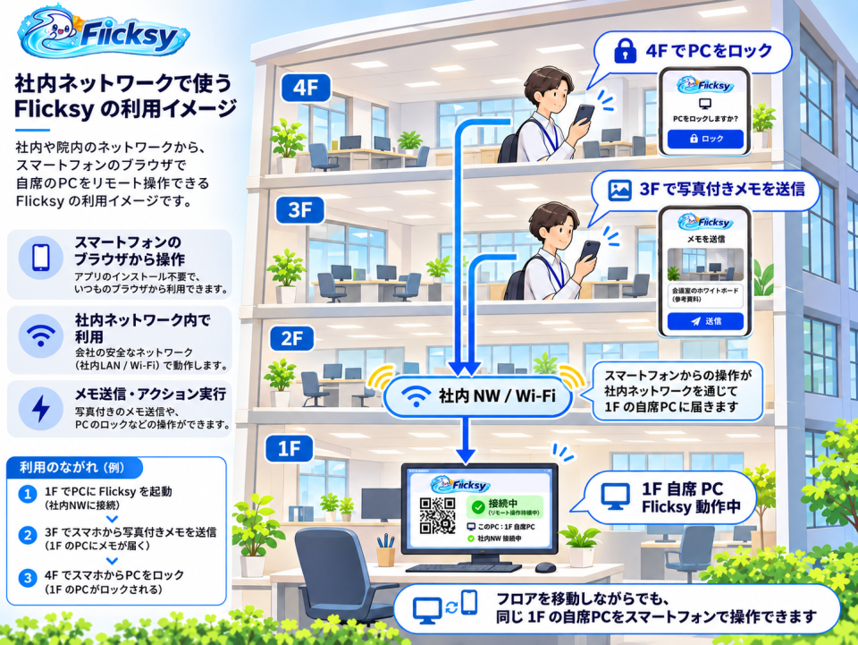
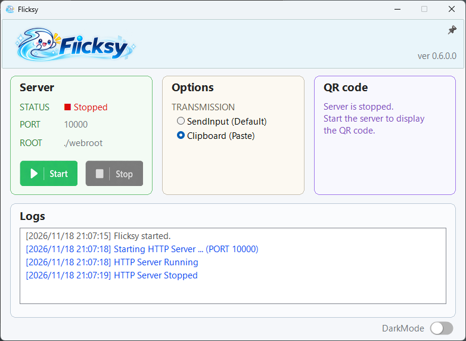
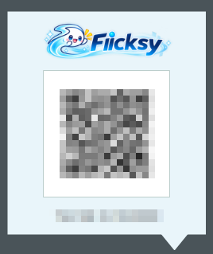
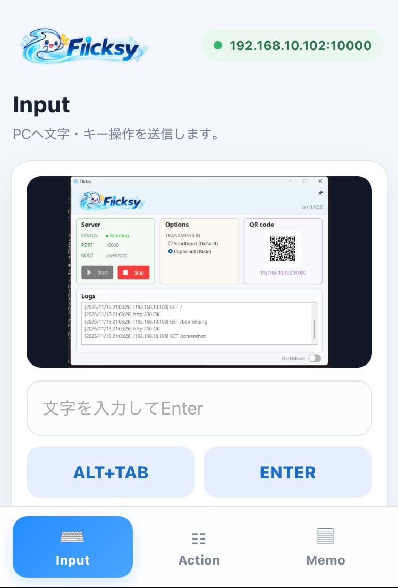
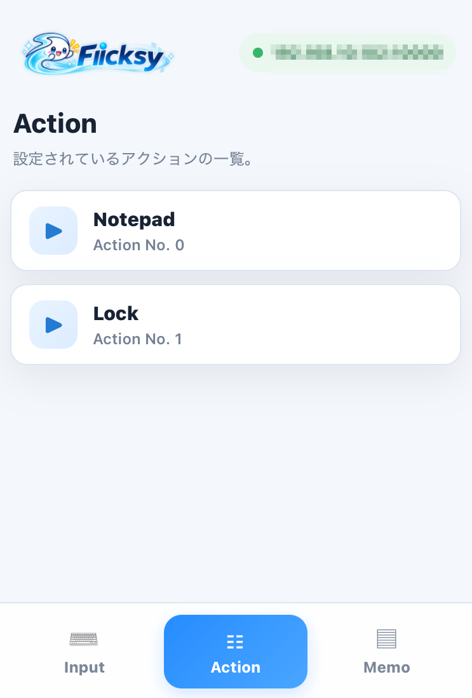
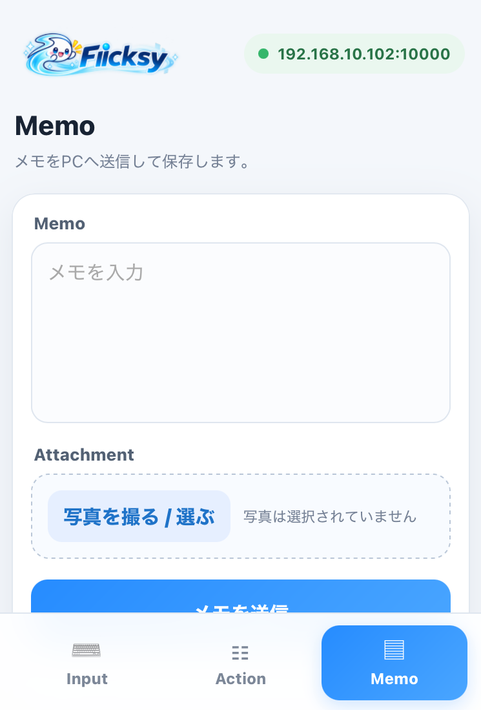

[English](README.md)

<div align="center">

# Flicksy v0.6.0.0

### スマートフォンのブラウザから、ローカルネットワーク / Wi-Fi 経由でWindows PCを操作できます。

**専用アプリは不要です。**  
PCでFlicksyを起動し、QRコードを読み取るだけで接続できます。



<br>

**Input · Screenshot · Action · Memo**

</div>

---

## What is Flicksy?

Flicksy は、同じローカルネットワーク / Wi-Fi 上にある Windows PC を  
スマートフォンのブラウザから操作するためのローカルリモートツールです。

スマートフォン側への専用アプリのインストールは不要です。  
PCでFlicksyを起動し、表示されたQRコードを読み取るだけで接続できます。

---

## Server / Client

<table>
<tr>
<td align="center" width="50%">

### Windows PC





</td>
<td align="center" width="50%">

### Smartphone







</td>
</tr>
</table>

---

## 主な機能

### ⌨️ Text & Key Input

- スマートフォンのフリック入力からPCへ文字を送信できます。
- **SendInput / Clipboard** の2種類の入力方式に対応しています。
- Enter、Esc、Tab、Backspace、カーソルキーなどを送信できます。
- Alt+Tabによるウィンドウ切り替えに対応しています。
- スクリーンショットでPCの状態を確認できます。

---

### 🖼️ Screenshot

- PCのアクティブウィンドウをスマートフォンから確認できます。
- スクリーンショットの全画面表示に対応しています。
- 必要なタイミングで画面を更新できます。
- スクリーンショット画面から基本的なキー操作を行えます。

---

### ⚡ Action

**Flicksy Config** で登録した操作を、スマートフォンからワンタップで実行できます。

対応するAction:

- Webサイトを開く
- アプリケーションを起動
- フォルダを開く
- Windowsをロック
- Windowsをシャットダウン

---

### 📝 Memo

スマートフォンからPCへメモを送信し、Flicksy内で管理できます。

- テキストメモ
- 画像添付
- JPEG / PNG / WebP対応
- Config画面でのメモ一覧・編集
- 添付画像プレビュー
- Windows既定の画像ビューアで表示
- 添付画像の保存
- 添付画像の削除

メモ情報は `fmemo.toml` に保存され、  
画像はData Folder配下に保存されます。

---

## 仕組み

```text
 Smartphone Browser
        │
        │  Local Network / Wi-Fi
        ▼
      Flicksy
        │
        ├─ Text / Key Input
        ├─ Screenshot
        ├─ Action
        └─ Memo
        │
        ▼
     Windows PC
```

Flicksy runs a local HTTP server on the Windows PC.  
The smartphone connects to it through a normal web browser.

---

## 使い方

1. Windows PCで `Flicksy.exe` を起動します。
2. `START` を押してローカルHTTPサーバーを開始します。
3. PCとスマートフォンを同じローカルネットワーク / Wi-Fiへ接続します。
4. Flicksyに表示されたQRコードをスマートフォンで読み取ります。
5. ブラウザでFlicksyのページを開きます。
6. 下部メニューから **Input / Action / Memo** を使用します。

`Start server automatically` を有効にすると、Flicksy起動時にサーバーを自動開始できます。

---

## コンフィグ

Config画面から以下を設定・管理できます。

- サーバー設定
- Action
- Memo
- Security
- 外観
- ログ
- Data Folder
- 自動起動・サーバー自動開始

---

## セキュリティ

Flicksyは標準で一時アクセストークンを使用します。

トークンはサーバー起動時に生成され、スマートフォン接続用URLへ付加されます。

Security設定からトークン認証を無効にすることもできます。

> [!WARNING]
> 認証トークンを無効にすると、同一ネットワーク上の他の端末からFlicksyへアクセスできる可能性があります。  
> 信頼できるネットワークでのみ使用してください。

### パスワード設定

Config画面には任意でパスワードを設定できます。

パスワードそのものは保存せず、ランダムSaltとPBKDF2によるハッシュ値を保存します。

> [!NOTE]
> Configパスワードは、設定画面への不用意なアクセスを防ぐための簡易的な保護機能です。  
> 設定ファイルを直接編集できるユーザーからの保護を目的とするものではありません。

---

## タスクトレイ

- トレイアイコンをダブルクリックするとメイン画面を表示します。
- ツールチップにサーバー状態を表示します。
- サーバーの開始、停止、エラー時に通知を表示します。
- トレイメニューから接続用QRコードを表示できます。

---

## v0.6.0.0

v0.6.0.0 主な変更:

- Memo機能を追加
- Memo画像添付に対応
- ConfigからのMemo管理機能を追加
- Action登録・編集機能を追加
- Configパスワード保護を追加
- アクセストークン認証のON/OFF設定を追加
- Config UI / オーナードローを改善
- スマートフォンUIを改善

---

## Roadmap

### v0.7 — Mouse Control

v0.7ではマウス操作機能を予定しています。

- スマートフォン側に専用の **Mouse** ページを追加
- タッチパッド方式の相対マウス移動
- 左クリック / 右クリック
- ホイール / スクロール操作
- スクリーンショットは画面確認用として利用
- スクリーンショット座標とPC座標の直接対応は行わない予定

---

## Development

- C++17
- Win32 API
- GDI / GDI+
- Visual Studio 2022
- HTML / CSS / JavaScript
- Local HTTP server

---

## Limitations

> [!WARNING]
> Administrator-elevated applications cannot receive remote text or key input from Flicksy when Flicksy is running without elevation.

Flicksy is designed primarily for use on trusted local networks.

---

## Dependencies

- [cpp-httplib](https://github.com/yhirose/cpp-httplib) - MIT License
- [QR-Code-generator](https://github.com/nayuki/QR-Code-generator) - MIT License
- [toml++](https://github.com/marzer/tomlplusplus) - MIT License
- [nlohmann/json](https://github.com/nlohmann/json) - MIT License

All third-party libraries listed above are licensed under the MIT License.

See `THIRD_PARTY_LICENSES.txt` for details.

Visual Studio 2022 project files are included.

---

## Status

**現在開発中です。**

個人開発のプロジェクトであり、現在も改善を続けています。

重要な用途や実運用へ導入する前に、利用環境で十分な検証を行ってください。

---

## License

This project is licensed under the MIT License.
